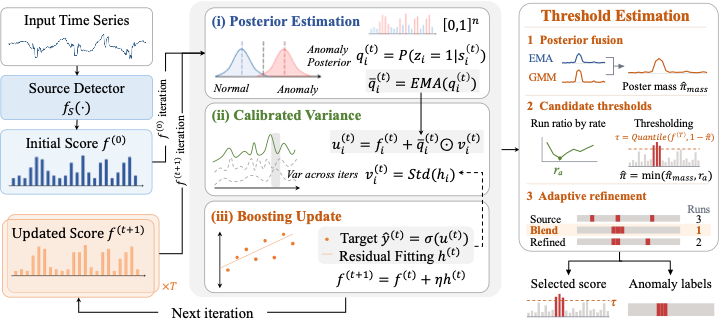

<p align="center">

</p>

<h2 align="center">PVBoost: Posterior-Calibrated Variance Boosting for Time-Series Anomaly Detection</h2>

## Table of contents

- [Overview](#overview)
- [Installation](#installation)
- [Quick start](#quick-start)
  - [Main options](#main-options-pvboostconfig)
- [Reproducing the TSB-AD experiments](#reproducing-the-tsb-ad-experiments)
- [Repository layout](#repository-layout)
- [Acknowledgement](#acknowledgement)

## Overview

Time-series anomaly detection (TSAD) is typically performed without supervision in two steps: *scoring*, which assigns each time step an anomaly score, and *thresholding*, which converts the scores into binary decisions. Prior work largely focuses on scoring and leaves thresholding to ad hoc heuristics, yet no threshold can recover an anomaly that the scores rank below normal fluctuations. This raises a key question: *given anomaly scores from a black-box detector, how can we both refine the scores and select a decision threshold without labels?*

To address this question, we propose **PVBoost**, an unsupervised, model-agnostic framework that couples score refinement, i.e., correcting the scores of a fixed detector, with threshold selection. PVBoost formulates refinement as iterative boosting and uses the variance of weak-learner predictions across iterations as a label-free indicator of abnormality, since anomalies are intrinsically harder to model. Because noise also produces such variance, PVBoost weights it by each time step's *anomaly posterior*, the probability of belonging to the anomalous component of a Gaussian mixture fitted to the current scores. Refined scores in turn sharpen the posteriors, forming a posterior–variance feedback loop, and the final posteriors, checked by a test of whether flagged time steps form contiguous segments, determine the threshold.
We perform an extensive evaluation using 16 statistical and neural detectors on an established TSAD benchmark ([TSB-AD](https://github.com/thedatumorg/TSB-AD)) comprising 530 time series across nine domains. Score refinement improves average threshold-independent VUS-PR by 6.9% and 15.6% over the original scores in the univariate and multivariate settings, respectively. Coupling refinement with threshold selection yields larger relative gains in average threshold-dependent F-score of 71.9% and 132.1%, respectively, over three-sigma thresholding of the original scores.

## Installation

```bash
git clone https://github.com/thedatumorg/PVBoost && cd PVBoost
pip install -r requirements.txt
pip install TSB-AD
```

PVBoost needs Python ≥ 3.9 and PyTorch ≥ 2.0. A GPU is used when available, but it is not required.

## Quick start

```python
from pvboost import PVBoost

# X: (T,) or (T, F) time series; source_score: (T,) score of any detector, higher = more anomalous
result = PVBoost(seed=0).fit_predict(X, source_score)

result.score          # refined anomaly score
result.labels         # binary decisions (1 = anomaly)
result.anomaly_rate   # estimated anomaly rate used for the threshold
result.a_star         # selected refinement strength (0 = source score, 1 = fully refined)
```

`python examples/quickstart.py` runs PVBoost end to end on a synthetic time series, using Isolation Forest as the source detector.

### Main options (`PVBoostConfig`)

| Option | Default | Meaning |
|---|---|---|
| `seed` | `0` | Random seed (weak learners, mixtures) |
| `device` | `None` | `'cuda:0'` if available, else `'cpu'` |
| `n_rounds` | `10` | Maximum boosting rounds; stops early once the posterior stabilizes |
| `eta` | `0.1` | Boosting step size |
| `ema_beta` | `0.7` | Momentum of the posterior across rounds |
| `gmm_k` | `2` | Mixture components (the highest-mean one is the anomaly component) |
| `window` | `None` | Lagged-feature window of the weak learner; `None` uses the dominant period |
| `refine_select` | `True` | Select the refinement strength; `False` always returns the fully refined score |

Pass options either as keyword arguments, `PVBoost(seed=1, refine_select=False)`, or as a `PVBoostConfig`.

## Reproducing the TSB-AD experiments

**1. Data.** Download TSB-AD-U and TSB-AD-M as described in the [TSB-AD repository](https://github.com/thedatumorg/TSB-AD). The evaluation lists are `Datasets/File_List/TSB-AD-{U,M}-Eva.csv` (350 univariate and 180 multivariate time series).

**2. Source scores.** PVBoost reads one precomputed score per time series from `<score_dir>/<detector>/<series>.npy`. Generate them with TSB-AD's own scripts, which use its tuned hyperparameters:

```bash
cd TSB-AD/benchmark_exp
python Run_Detector_U.py --AD_Name Sub_IForest --dataset_dir ../Datasets/TSB-AD-U/ \
    --file_lsit ../Datasets/File_List/TSB-AD-U-Eva.csv --score_dir <SCORE_ROOT>/uni/
python Run_Detector_M.py --AD_Name IForest --dataset_dir ../Datasets/TSB-AD-M/ \
    --file_lsit ../Datasets/File_List/TSB-AD-M-Eva.csv --score_dir <SCORE_ROOT>/multi/
```

**3. Run PVBoost.** For one detector and seed:

```bash
python benchmark/run_tsbad.py --benchmark U --detector Sub_IForest --seed 0 \
    --dataset_dir <TSB-AD>/Datasets/TSB-AD-U --score_dir <SCORE_ROOT>/uni \
    --file_list <TSB-AD>/Datasets/File_List/TSB-AD-U-Eva.csv --save_dir results
```

For all 16 detectors × 3 seeds on both benchmarks, followed by the summary table:

```bash
TSBAD_ROOT=<TSB-AD> SCORE_ROOT=<SCORE_ROOT> JOBS=4 bash benchmark/run_all.sh
```

`run_all.sh` expects the datasets under `<TSB-AD>/Datasets/TSB-AD-{U,M}`. Each run writes `results/TSB-AD-{U,M}/PVBoost_<detector>_seed<s>.csv`, with per-series VUS-PR, AUC-PR and the other TSB-AD metrics of the returned score. It also records `F1`, the point-wise F-score of PVBoost's own decisions, plus the estimated rate `pi_hat` and the selected strength `a_star`. `python benchmark/summarize.py --save_dir results` averages these over time series and seeds per detector.

Results are deterministic for a given seed and device. GPU and CPU runs can differ slightly in floating point.

## Repository layout

```
pvboost/
  core.py           PVBoost: boosting loop, final posterior, threshold, refinement strength
  model.py          weak learner (MLP) and its K-fold training
  thresholding.py   anomaly-rate estimation and refinement-strength selection
  window.py         period-based window length
benchmark/
  run_tsbad.py      PVBoost on TSB-AD-U / TSB-AD-M with precomputed source scores
  run_all.sh        all detectors x seeds, then summary
  summarize.py      per-detector table
examples/
  quickstart.py
```

## Acknowledgement

PVBoost builds on the following repositories:

* [UADB](https://github.com/HangtingYe/UADB)
* [TSB-AD](https://github.com/thedatumorg/TSB-AD) (datasets, metrics, and detector implementations)